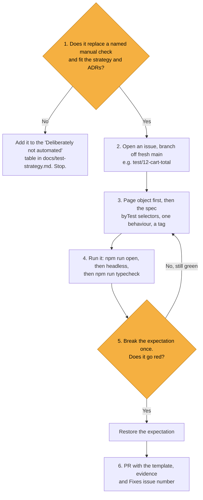
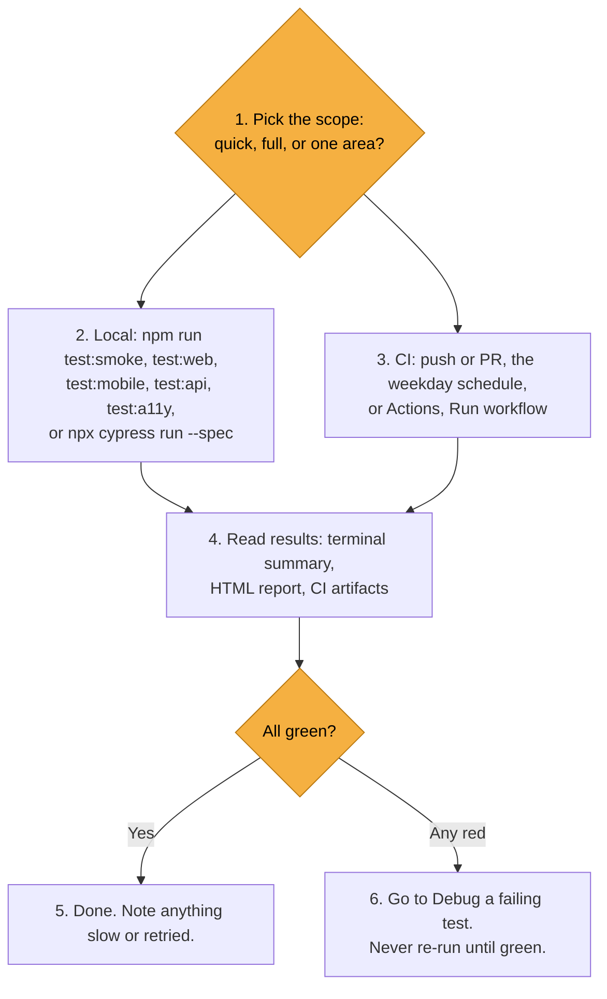
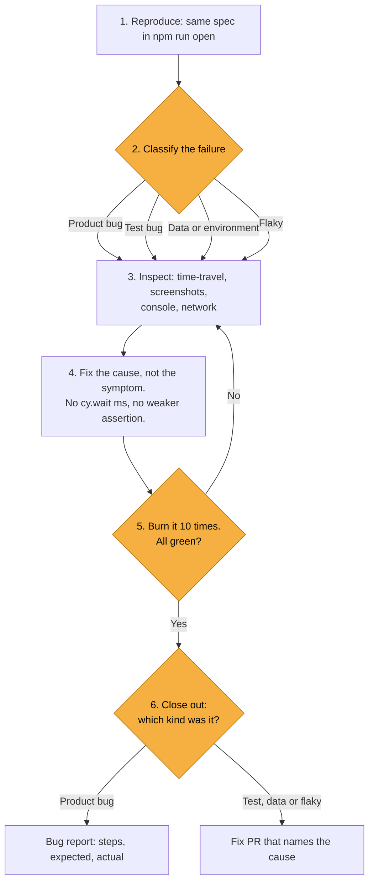
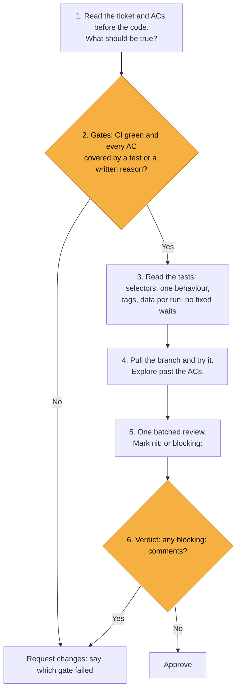

# Everyday QA workflows

The four tasks repeated most in this repo. People and Claude Code follow the same steps.

In each flowchart, amber diamonds are decisions. Commands and paths are the real ones from `package.json`, `cypress.config.ts` and `.github/workflows/cypress.yml`.

| Workflow | Use it when | Step most often skipped |
|---|---|---|
| [Add a new test](#1-add-a-new-test) | A manual check should become automated | 5: prove it can fail |
| [Run tests](#2-run-tests) | You need confidence in a change or in the demo apps | 5: reading red as "re-run" |
| [Debug a failing test](#3-debug-a-failing-test) | Anything is red, locally or in CI | 2: classify before fixing |
| [Review a PR as QA](#4-review-a-pr-as-qa) | A PR is ready for review | 1: read the ACs before the code |

## 1. Add a new test

1. **Should it exist?** It must replace a named manual check and fit [`docs/test-strategy.md`](test-strategy.md) and the [ADRs](adr/README.md). If not, add it to the strategy's "Deliberately not automated" table instead. Don't add tests for the seeded defects (`problem_user`, `error_user`).
2. **Issue, then a branch off fresh main:** `git switch main && git pull --ff-only && git switch -c test/12-cart-total`.
3. **Page object first, then the spec.**
   - Selectors are `[data-test="..."]` through `byTest()` in `src/pages/selectors.ts`. No CSS chains, no XPath.
   - Page objects in `src/pages/` hold selectors and actions only. Business assertions go in the spec.
   - One behaviour per test, with a `tags` option of `@smoke` or `@regression`.
   - Chain Cypress commands. No `async/await`, no `cy.wait(<number>)`. UI login goes through `cy.login(user)`.
   - The title matches the Playwright twin. If there is no twin, add the reason to the strategy's "Tests with no Playwright twin" table.
4. **Run it:** `npm run open` to watch it, then `npx cypress run --spec cypress/e2e/ui/<file>.cy.ts` headless, then `npm run typecheck`.
5. **Prove it can fail.** Break the expectation once, for example a wrong expected total, and check it goes red for the right reason. If it stays green, it tests nothing. Restore the expectation afterwards.
6. **PR** using `.github/pull_request_template.md`: fill in "Manual check replaced", tick the checklist, attach evidence (run output or report screenshot) and write `Fixes #<issue>`.

## 2. Run tests

1. **Pick the scope.**

   | Need | Command |
   |---|---|
   | Quick confidence | `npm run test:smoke` |
   | Desktop UI, including accessibility | `npm run test:web` |
   | UI `@smoke` at a Pixel 7 sized viewport | `npm run test:mobile` |
   | API | `npm run test:api` |
   | Accessibility only | `npm run test:a11y` |
   | Everything | `npm test` |
   | One spec | `npx cypress run --spec cypress/e2e/ui/login.cy.ts` |
   | Tests by title | `npx cypress run --expose grep="locked out"` |

2. **Local:** run the command from the table. Base URLs default to the public demo apps. Override them with `UI_BASE_URL` or `API_BASE_URL` (see `.env.example`).
3. **CI:** `.github/workflows/cypress.yml` runs on every push to `main`, on every PR, on weekdays at 06:23 UTC, and on demand from Actions, "Cypress tests", Run workflow. Typecheck runs first, then a matrix of `web`, `mobile` and `api`. Those four checks are required by the `protect-main` ruleset.
4. **Read results:**
   - the terminal summary
   - the HTML report at `cypress/reports/html/index.html`, with failure screenshots embedded
   - screenshots in `cypress/screenshots/`
   - in CI, the `cypress-report-web`, `cypress-report-mobile` and `cypress-report-api` artifacts, kept for 14 days
5. **All green:** done. Headless runs retry a failed test once (`retries.runMode: 1`), so a green run can hide a flaky test. Check the report for retried tests and note anything slow or retried.
6. **Any red:** go to [Debug a failing test](#3-debug-a-failing-test). Never re-run until it goes green.

## 3. Debug a failing test

1. **Reproduce** the same spec locally in `npm run open`. For a CI failure, download that suite's `cypress-report-<suite>` artifact first. For the mobile suite, reproduce with `MOBILE=1 npm run open`.
2. **Classify** before you change anything. This is the key step.

   | Class | Signs | Goes to |
   |---|---|---|
   | Product bug | The app is wrong. Reproduces by hand. | Bug report |
   | Test bug | The test is wrong: selector, assumption, ordering | Fix PR |
   | Data or environment | The demo app is down or slow, data changed, base URL wrong | Fix the setup, or wait it out and note it |
   | Flaky | Passes and fails with no code change | Find the race, then a fix PR |

   SauceDemo and Restful-Booker are third-party. A changed quirk gets asserted and commented, never "fixed" in the test.
3. **Inspect:** time-travel through each command in the Cypress app, then check the screenshot, the browser console and the network requests (`cy.intercept` can make a request visible).
4. **Fix the cause, not the symptom.** No `cy.wait(<number>)`, no weaker assertion, no axe rule switched off wholesale. Wait on a state the app exposes, such as an element, a URL or an intercepted request.
5. **Prove the fix** by running it ten times with retries off, so a retry can't hide a flake:
   `npx cypress run --spec cypress/e2e/ui/<file>.cy.ts --expose burn=10 --config retries=0`
   Add `grep="<title>"` to the `--expose` list to burn a single test.
6. **Close out:** a product bug gets a bug report (steps to reproduce, expected result, actual result, environment). A test bug gets a fix PR that names the cause.

## 4. Review a PR as QA

1. **Read the ticket and ACs before the code.** Write down what should be true when the PR is merged.
2. **Check the gates:**
   - CI is green: `typecheck`, `test (web)`, `test (mobile)`, `test (api)`.
   - Every AC is covered by a test or a written reason.
   - The PR template is filled in, including "Manual check replaced".
3. **Read the tests:**
   - `byTest()` selectors
   - one behaviour per test
   - a `@smoke` or `@regression` tag
   - data generated per run, not shared state
   - no `cy.wait(<number>)`, no `async/await`
   - titles that match the Playwright twin
   - structural changes come with a new ADR
4. **Try it:** `gh pr checkout <number>`, then `npm ci` and run the affected suite. This repo has no preview environment. Explore past the ACs: edge cases, the mobile viewport, a failing run.
5. **Comment as one batched review**, not a stream of single comments. Start each comment with `nit:` (optional) or `blocking:` (must change before merge).
6. **Verdict:** approve, or request changes with the reasons. All review threads must be resolved before `protect-main` allows the squash merge.
